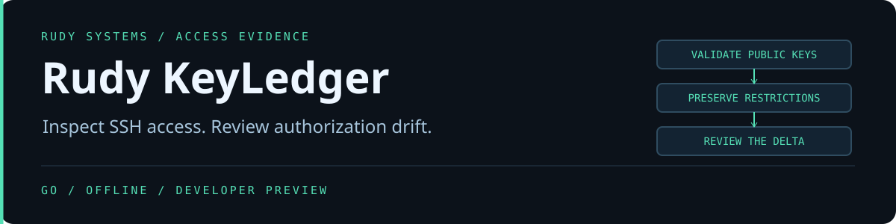

<p align="center"></p>

<p align="center"><a href="https://rudy.systems">Rudy Systems</a> · <a href="https://github.com/r4venrudy/rudy-keyledger/releases">Native downloads</a> · <a href="#quick-start">Quick start</a> · <a href="#analysis-boundaries">Analysis boundaries</a></p>

# Rudy KeyLedger

**Review SSH access changes before deploying them.** KeyLedger is an offline Go library and command-line tool for `authorized_keys` inventory, public-key validation, policy warnings, and authorization drift checks.

A key can keep the same fingerprint while losing its forced command or forwarding restrictions. KeyLedger compares the key **and every ordered option set**, retaining duplicate records. It reports the before/after lines so an operator can review precisely what changed.

**v0.1.0-preview · Go · MIT · Standard library only**

## Capabilities

| Layer | Behavior |
| --- | --- |
| Key decoding | Parse SSH wire strings, match the advertised algorithm, reject truncated/trailing data, and compute SHA-256 fingerprints. |
| Supported keys | Ed25519, RSA with canonical positive integers, ECDSA nistp256/nistp384/nistp521 with on-curve uncompressed point validation. |
| Access options | Preserve order, repeated values, quoted commas/spaces and OpenSSH-style escaped quotes; normalize option keyword case. |
| Inventory | Line references, algorithms, sizes, comments, options, duplicate keys and configurable policy warnings. |
| Drift | Added keys, removed keys, modified option sets and changed duplicate counts; ignore comments and record order. |
| Deployment checks | Stable JSON schemas, stdin support and distinct exits for clean results, review gates and invalid input. |

## Quick start

Download the archive for your platform from the [preview release](https://github.com/r4venrudy/rudy-keyledger/releases/tag/v0.1.0-preview). Compare its SHA-256 with `SHA256SUMS.txt`, extract it, then run `bin/keyledger` (`bin/keyledger.exe` on Windows). The archive includes these examples.

```sh
bin/keyledger inspect --input examples/before.keys --format json
bin/keyledger inspect --input examples/after.keys --require-restrict --fail-on-warning
bin/keyledger diff --before examples/before.keys --after examples/after.keys --format json
```

The first command inventories two synthetic keys. The second flags the missing `restrict` option. The third reports one `authorization-changed` record because a key lost both `restrict` and its forced command. **The latter two commands intentionally exit 1.**

Comment changes and entry reordering are ignored:

```sh
bin/keyledger diff --before examples/before.keys --after examples/equivalent.keys
# SSH access drift: false | entries 2 -> 2 | changed keys 0
```

For a real deployment, provide your own previous and prospective files explicitly:

```sh
keyledger inspect --input ./authorized_keys --min-rsa-bits 3072 --forbid-ca --fail-on-warning
keyledger diff --before ./approved_keys --after ./proposed_keys --require-restrict --fail-on-warning
cat ./proposed_keys | keyledger diff --before ./approved_keys --after - --format json
```

`diff` exits 1 for **any** authorization drift. Review the change and update your approved file through your normal change process. `--fail-on-warning` additionally gates the prospective file's policy warnings. Old warnings remain in `before_issues` as evidence.

| Exit | Meaning |
| --- | --- |
| 0 | Input is supported and valid; no requested gate fired. Warnings alone do not fail unless requested. |
| 1 | Authorization drift, or policy warnings with `--fail-on-warning`. A complete report is emitted. |
| 2 | Invalid/unsupported input, argument, file or output error. No partial success JSON is emitted. |

Policy warnings cover RSA below the selected size (2048 bits by default), duplicate key records, unknown option names, unexpected bare/value forms, repeated `command`/`from`/`principals` clauses, and the optional `restrict`/CA policies. `--require-restrict` requires an explicit flag; it does not infer equivalent configurations.

## Build and test

Use Go **1.27.3** for the pinned build. Python 3.13 is used only for integration tests and archive assembly. The core and CLI have no third-party dependencies.

```sh
go vet ./...
go test -cover ./...
go build -mod=readonly -trimpath -o bin/keyledger ./cmd/keyledger
python tests/integration.py bin/keyledger .
go test ./keyledger -run '^$' -fuzz '^FuzzRead$' -fuzztime=12s -parallel=2
python tools/package.py
```

On Windows change the output path to `bin/keyledger.exe` in the build and integration commands. `tools/package.py` cross-builds Linux x64, Windows x64 and macOS arm64 with CGO disabled, trimmed build paths and fixed archive metadata. It creates three archives and `dist/SHA256SUMS.txt`.

CI runs unit, native CLI and OpenSSH comparison tests on all three operating systems, race tests and parser fuzzing on Linux, and verifies a packaged Linux executable. The integration suite independently recomputes all five example fingerprints using Python SHA-256 and, when installed, compares their fingerprints and sizes against `ssh-keygen -lf`. CI requires that OpenSSH comparison tool to be present.

## Library

```go
old, err := keyledger.Read(oldFile, keyledger.Policy{MinRSABits: 3072})
if err != nil { return err }
next, err := keyledger.Read(newFile, keyledger.Policy{RequireRestrict: true})
if err != nil { return err }
delta := keyledger.Compare(old, next)
```

Import `github.com/r4venrudy/rudy-keyledger/keyledger`. `Policy.MinRSABits` must be zero (the 2048-bit default) or between 1024 and 16384. Invalid policy settings fail before reading input. `Read` returns an error for the entire file if any record is unsupported or malformed. `Compare` expects inventories produced by successful `Read` calls. JSON schemas are `rudy.keyledger.inventory/v1` and `rudy.keyledger.diff/v1`.

## Analysis boundaries

KeyLedger examines explicitly supplied public access files. It does not connect to hosts, modify keys, invoke embedded commands, read private keys, scan home directories or contact an external service. JSON reports retain comments and option values, so treat reports with the same care as the input file.

Line iteration does not allocate a slice entry for every blank or comment line. A regression checks allocation work on a one-MiB blank input. This preview accepts UTF-8 files up to 8 MiB, 8192 bytes per line, 16384 entries and 128 options per key. Oversized option fields are rejected by byte length before text scanning. The exported option parser enforces the same UTF-8 and control-character profile as file input. Quoted tabs remain supported. CRLF is accepted; a BOM, lone CR and control characters are rejected. RSA keys must have an odd 1024–16384-bit modulus and a canonical odd exponent from 3 through 2147483647. RSA checks cover public structure, not factorization or strength beyond size. Ed25519 validation covers wire shape and length, not subgroup membership or possession of a private key.

Certificates, DSA, FIDO/security-key records and post-quantum/hybrid algorithms are outside this preview and fail the entire read. A `cert-authority` option on a supported ordinary public key is retained and can be forbidden by policy.

Option order within one record remains significant to the comparison. Changing it is conservatively reported even when a particular sshd version would treat it as equivalent. Repeated key records are compared as a multiset, never reduced to one fingerprint. Unknown options are preserved with a warning. Both `touch-required` and `no-verify-required` are recognized. Repeated `command`, `from` and `principals` values are retained with a warning because OpenSSH rejects those duplicates; other repeated options are not classified as singleton errors. See the [OpenSSH option parser](https://github.com/openssh/openssh-portable/blob/master/auth-options.c). KeyLedger does not evaluate host patterns, expiry times, forced-command semantics, sshd configuration, file permissions, principals, revocation files or effective login permissions. Confirm deployment behavior against your sshd configuration.

The parser profile follows the [OpenSSH authorized_keys format](https://man.openbsd.org/sshd.8#AUTHORIZED_KEYS_FILE_FORMAT). Key layouts are defined by [RFC 4253](https://www.rfc-editor.org/rfc/rfc4253#section-6.6), [RFC 5656](https://www.rfc-editor.org/rfc/rfc5656#section-3.1), and [RFC 8709](https://www.rfc-editor.org/rfc/rfc8709#section-4). The synthetic public fixtures are for parser tests and documentation; never use them to grant access.

---

<p align="center"><strong>RUDY SYSTEMS</strong><br>Systems engineering · Security research · Reviewable evidence<br><a href="https://rudy.systems">rudy.systems</a></p>
